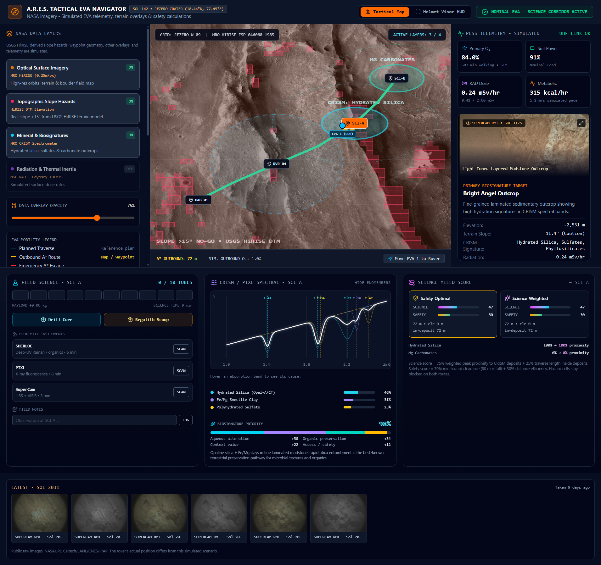

# A.R.E.S. Tactical EVA Navigator

A layered map and safety planner for a Mars astronaut on a spacewalk in Jezero Crater, built for the **2026 NASA Space Apps Challenge** (Mars Marswalk map challenge).



**[Live app](https://mars-bar.vercel.app)** ·  · **[GitHub repo](https://github.com/Ac-Ey/mars_bar)**

**Contents**
- [Why this exists](#why-this-exists)
- [Highlights](#highlights)
- [What is real vs simulated](#what-is-real-vs-simulated)
- [Quick start](#quick-start)
- [Built with](#built-with)
- [Main controls and features](#main-controls-and-features)
- [Science Operations deck](#science-operations-deck)
- [60-second pitch demo order](#60-second-pitch-demo-order)
- [Escape routing and oxygen planning](#escape-routing-and-oxygen-planning)
- [Regenerating the terrain data](#regenerating-the-terrain-data-optional)
- [Browser verification](#browser-verification)
- [Checks and code layout](#checks-and-code-layout)
- [Assumptions and limitations](#assumptions-and-limitations)
- [Data sources and credits](#data-sources-and-credits)

## Why this exists

Global tools like Mars Trek show regions of Mars. An astronaut on a single Marswalk needs a hyperlocal view: where the steep ground is, how much oxygen a route costs, when to turn back, and where to run in an emergency. A.R.E.S. puts those in one screen for a 1 km square of Jezero Crater.

## Highlights

- **Real terrain hazards:** red no-go cells are slopes over 15°, computed from the USGS HiRISE terrain model of Jezero, and an A\* pathfinder routes around them.
- **Live EVA walk:** the astronaut moves along the route, oxygen burns down, and the app warns before the point of no return.
- **Emergencies:** a solar flare or suit-oxygen drop reroutes the astronaut from their current position to the right shelter, even mid-walk.
- **Science Operations deck:** sample logger, spectral analyzer, and a Science-vs-Safety route comparison.
- **Helmet-visor HUD** and a strip of recent **Perseverance raw images** from NASA's public feed.

## What is real vs simulated

| Real NASA / USGS data | Simulated (labeled in the app) |
|---|---|
| Slope hazards: 50×50 grid from the USGS HiRISE DTM of Jezero (1 m elevation posts, 5 m slope baseline, >15° blocked) | Suit telemetry: O₂, power, radiation dose, metabolic rate |
| Latest Perseverance raw images from NASA's public Mars 2020 feed | Oxygen model, reserve rules, GO / CAUTION / NO-GO decisions |
| Orbital imagery and instrument captions (HiRISE, CRISM references) | Solar-flare and oxygen-drop events, radiation overlay |
| | Science Operations data: spectra, mineral percentages, SHERLOC / PIXL / SuperCam readings, biosignature scores |
| | Waypoint names and positions, and the schematic 1 km map scale |

> **Simulation only.** This is not a flight tool and makes no real-world life-support or instrument-accuracy claims.

## Quick start

```bash
git clone https://github.com/Ac-Ey/mars_bar.git
cd mars_bar
npm install
npm run dev     # opens at http://localhost:5173
```

Run the checks with `npm test`, `npm run lint`, and `npm run build`.

## Built with

React, Vite, Tailwind CSS, JavaScript, and Node's built-in test runner. A Python script (rasterio, NumPy, Pillow) turns the USGS terrain data into the hazard grid. Hosted on Vercel.

## Main controls and features

### A. NASA data layers (left panel)

- **Optical Surface Imagery (MRO HiRISE):** high-res orbital surface basemap of Jezero Crater.
- **Topographic Slope Hazards (USGS HiRISE DTM):** shows cells above the 15° slope threshold as red No-Go areas; the source crop's maximum slope is 58.6°.
- **Mineral & Biosignatures (MRO CRISM):** marks high-value hydrated silica and carbonate science targets.
- **Radiation & Thermal Inertia (MSL RAD + Odyssey THEMIS):** shows simulated surface dose rates.
- **Data Overlay Opacity Slider:** adjust transparency (15%–100%) to inspect the raw orbital surface beneath the overlays.

### B. Dynamic A\* pathfinder (center map)

- The green traverse is a reference; the amber A\* route is calculated from EVA-1's current position to the selected waypoint or a custom map target.
- Click safe terrain to set a custom target (A\* TGT). The 50×50 pathfinder avoids grid cells classified as No-Go by the USGS HiRISE slope mask; the route distance (m) and simulated outbound O₂ use appear below the map.
- Click a blocked red cell to see the NO-GO warning. Hiding the slope overlay changes only its visibility; blocked cells still prevent routing.
- Routes recalculate when the target or EVA-1's position changes. Emergency scenarios calculate an escape route to an eligible reachable destination.
- Use the **Move EVA-1** button (bottom right of the map) to simulate astronaut movement between the rover and science outcrop. It is disabled while a Live EVA Walk is active.

### C. Waypoint inspection and rover POV photos (right panel)

- Click any map pin (HAB-01, RVR-04, SCI-A, SCI-B) to view elevation, slope angle, mineral signatures, and radiation levels.
- Click the ground-level NASA Perseverance photo card to expand it full-screen.

### D. Helmet visor AR HUD mode (top bar toggle)

- Click **Helmet Visor HUD** in the top header to switch into a first-person astronaut visor overlay.
- It shows a live compass heading tape, suit incline pitch, a distance-to-target AR lock box, and ground-level terrain imagery.
- Use the bottom **Visor Waypoint Lock** buttons (HAB-01 to SCI-B) to switch views.

### E. Contingency and emergency simulator (bottom left)

- **Simulate Solar Flare (SEP):** triggers a simulated radiation spike, turns the HUD/visor red, and calculates an A\* escape route from EVA-1 to HAB-01, the only explicitly radiation-shielded shelter. RVR-04 is not a radiation shelter.
- **Simulate Suit O₂ Drop:** sets simulated oxygen to 41% and routes to the closest reachable oxygen support by routed distance (RVR-04 or HAB-01).
- **Restore Nominal EVA Plan:** resets all suit vitals and restores the primary science route.

### F. Live EVA walk (left panel)

- Select a target, then use **Start EVA** to walk along its A\* route. Pause or resume at any time; **Reset** returns to the start of the walk and restores the oxygen present when the walk began. If an emergency reroute happened mid-walk, Reset still returns to the original start point and oxygen.
- Choose 1x, 10x, 20x, or 50x simulation speed (20x by default). EVA-1's map marker, route planning, emergency routing, and displayed O₂ follow the simulated walk.
- Start EVA is disabled, with a message, when no safe route to the current target exists.
- The return-safety check compares current O₂ with the A\*-routed oxygen cost back to HAB-01 plus the configured reserve:
  - **OK:** the reserve is preserved.
  - **WARNING:** the remaining margin is small.
  - **TURN BACK:** the reserve would be spent.
  - **CRITICAL:** there is not enough O₂ for the return.
  - **NO ROUTE HOME:** A\* cannot find a safe return path.
- Trigger Solar Flare or Suit O₂ Drop during a walk to reroute EVA-1 from its current position to the appropriate emergency destination, preserving current O₂. These are simulations, not validated life-support predictions.

### G. Latest Perseverance images (below the dashboard)

- The horizontal strip requests recent public raw images from NASA's Mars 2020 feed, sorted by rover sol.
- Up to six unique frames are shown with their instrument and sol. EBY and ECM image products from the same frame are deduplicated.
- Select a thumbnail to open the existing full-screen image lightbox at the larger image resolution. Close the lightbox to return to the dashboard.
- The feed is cached in memory for 10 minutes and the request times out after 6 seconds. If the feed is unavailable, the strip displays an unavailable/archive status; the rest of the dashboard remains usable.

## Science Operations deck

The navigator supports hands-on field science as well as safe traversal. A **Science Operations** deck below the map has three linked tools. All values are illustrative simulation data based on published Jezero Crater mineralogy; they are not calibrated NASA measurements.

### 1. Interactive field science and sample logger

Collect and log science at each waypoint (HAB-01, RVR-04, SCI-A, SCI-B):

- **Sample collection**
  - **Drill Core:** only at science targets (SCI-A, SCI-B). 0.12 kg per tube.
  - **Regolith Scoop:** at any waypoint. 0.09 kg per tube.
- **Suit sample tube capacity:** a 10-tube bar fills as you collect (for example `4 / 10 tubes`). Total **payload mass** is tracked live.
- **Virtual proximity instruments**
  - **SHERLOC** (deep-UV Raman): looks for organic signatures (for example a Raman G-band candidate at SCI-A).
  - **PIXL** (X-ray fluorescence): bar chart of the main rock chemistry (SiO₂, FeO, MgO, SO₃, CaO).
  - **SuperCam** (LIBS + VISIR): elemental and hydration confirmation.
- **Science time budget:** each action adds simulated EVA minutes (core 12, scoop 5, SHERLOC 6, PIXL 8, SuperCam 3).
- **Field notes:** timestamped notes for each waypoint.
- **Sample manifest:** a list of every tube (waypoint, type, mass, time), with an option to discard.
- **Persistent:** samples, scans and notes are saved in `localStorage` and survive a page reload.
- **Contingency lock:** all science actions are disabled during a Solar Flare or O₂ Leak emergency.

### 2. CRISM / PIXL spectral signature analyzer

Explains *why* a target has its biosignature priority:

- **Reflectance spectrum (1.0–2.6 µm):** a mixed spectrum for the selected waypoint, with an optional overlay of each mineral's individual curve.
- **Interactive absorption bands:** hover a marked band to see its cause:
  - `1.41 µm`: Si-OH / H₂O overtone
  - `1.91 µm`: molecular H₂O
  - `2.21 µm`: Si-OH (diagnostic for hydrated silica)
  - `2.30 / 2.50 µm`: carbonate doublet (diagnostic for Mg-carbonates)
- **Mineral composition breakdown:** percentage of each mineral (for example SCI-A: 46% hydrated silica, 31% Fe/Mg smectite, 23% sulfate).
- **Biosignature priority breakdown:** the score (for example **98%** for SCI-A) is split into Aqueous Alteration, Organic Preservation, Context Value and Access/Safety, with a short scientific explanation.

### 3. Science priority scoring along routes (Science Yield Score)

Compare routes by **safety vs. science return** for any waypoint or custom map target:

- **Two A\* routes** are computed from the astronaut's position:
  - **Standard A\*:** a safe route that minimizes the pathfinder's traversal cost.
  - **Science-Weighted:** the path is pulled toward the CRISM deposits (Hydrated Silica, Mg-Carbonates) by lowering the travel cost of cells near them.
- **Hazards are never relaxed:** both routes stay out of cells blocked by the active terrain. In real-DTM mode, routing uses the slope grid; it does not model dust traps.
- **Science Score (0–100)** = 75% weighted closest approach to each deposit + 25% distance walked inside deposit zones (full credit at 300 m).
- **Safety Score (0–100)** = 70% minimum clearance from hazards (full credit at 80 m) + 30% distance efficiency compared with the safest route.
- **Per-deposit comparison:** for example `Hydrated Silica 40% → 100% proximity`.
- **Map overlay:** select the Science-Weighted card to draw its route in pink. The mineral layer also shows each deposit's influence zone (2.5× its outline).

## 60-second pitch demo order

1. Start on the Tactical Map and toggle the four map layers and the opacity slider. Say: "These red cells are real USGS HiRISE slopes over 15°."
2. Click safe terrain near a red slope cell to show A\* obstacle avoidance, then click a red cell to trigger the safety warning.
3. Switch to Helmet Visor HUD in the header and cycle through SCI-A and RVR-04.
4. Click **Simulate Solar Flare (SEP)** to demonstrate real-time emergency rerouting.
5. Start the Live EVA Walk toward a selected target; show the moving marker, O₂ burn, and return-safety status. Trigger an emergency to show a mid-walk reroute.
6. Scroll below the dashboard, open a recent Perseverance thumbnail, and show it in the full-screen lightbox.
7. Scroll to the Science Operations deck: log a drill core at SCI-A, open its spectrum (hover the 2.21 µm band), then compare the Standard and Science-Weighted routes.

## Escape routing and oxygen planning

The dashboard keeps the original map, NASA image assets, layer controls, waypoint cards, photo lightbox, and helmet visor. The green traverse remains a reference plan. The amber A\* line shows the current outbound plan; a red dashed A\* line takes priority during emergencies. The recommended emergency pin has a red outline.

The emergency panel shows type, destination, escape distance, travel time, remaining O₂, escape O₂ requirement, and feasibility warnings. Moving EVA-1 immediately recalculates the route. If no eligible destination is reachable, the app shows a no-safe-route warning and draws no escape line. If the terrain route exists but oxygen is insufficient, the route stays visible with NO-GO and an explicit oxygen warning. Clicking map terrain during an emergency cannot override the escape route; waypoint and photo inspection remain available.

The **EVA O₂ / RETURN SAFETY** panel plans EVA-1 → selected waypoint (or custom map target) → HAB-01. Outbound and return legs are calculated separately using the same A\* implementation. Selecting a waypoint clears a custom target. During emergencies this calculator remains a mission preview; the emergency panel describes the immediate escape without exploration or a further return leg.

### Simulation formulas

All oxygen percentages are percentage points of a full illustrative suit tank:

- Walking O₂ = routed distance in meters ÷ 100 × 1.4% (the existing app's simulation coefficient).
- Exploration O₂ = exploration minutes × 0.2%.
- Total requirement = outbound O₂ + return O₂ + exploration O₂ + configured reserve.
- O₂ left after mission = available O₂ − outbound O₂ − return O₂ − exploration O₂. The reserve must remain in this balance; it is not an extra activity that consumes oxygen.
- Travel minutes = routed meters ÷ 1.2 m/s ÷ 60. The suit's remaining walking-time estimate uses these same simulation coefficients.
- **GO** means the mission fits while preserving the full reserve. **CAUTION** means travel and exploration fit but the reserve would be short. **NO-GO** means oxygen is insufficient even before reserve, a route is unavailable, or inputs are invalid.

Available O₂, exploration time, and reserve can be edited in the panel. Starting or restoring a scenario resets available O₂ to its sample value (84% nominal, 79% solar flare, 41% oxygen drop); exploration and reserve settings persist. Calculations keep full precision internally and round only for display. A zero-distance route consumes zero walking O₂.

## Regenerating the terrain data (optional)

The slope hazards come from a USGS HiRISE terrain model. A Python script crops a 1 km × 1 km square, computes slope, and writes the files the app uses. You only need this to change the map location or refresh the data.

- **Requirements:** Python 3.9+, then `pip install rasterio numpy pillow`.
- **Script:** `terrain/make_terrain.py`. It streams only the 1 km crop from USGS, so you do not need to download the full 1.8 GB file.
- **Run** (one line; `--ortho` also crops the matching orthoimage as a basemap, which is slower):

```bash
python make_terrain.py --dem "https://planetarymaps.usgs.gov/mosaic/mars2020_trn/HiRISE/JEZ_hirise_soc_006_DTM_MOLAtopography_DeltaGeoid_1m_Eqc_latTs0_lon0_blend40.tif" --ortho "https://planetarymaps.usgs.gov/mosaic/mars2020_trn/HiRISE/JEZ_hirise_soc_006_orthoMosaic_25cm_Eqc_latTs0_lon0_first.tif" --lat 18.46 --lon 77.36 --out public/terrain_a
```

- **Options:** `--lat` / `--lon` (crop center; keep inside 18.31–18.67°N, 77.22–77.58°E), `--threshold` (no-go slope in degrees, default 15), `--block-fraction` (share of steep pixels that blocks a cell, default 0.25).
- **Outputs:** `terrain.json` (50×50 hazard grid, plus per-cell mean elevation and slope), `slope_overlay.png`, and `basemap.png` (with `--ortho`).
- **Install:** copy `terrain.json` to `src/data/jezeroTerrain.json`, and `basemap.png` to `public/nasa/jezero_hirise.png`. Then run `npm test`.
- Avoid the far-western edge of the DTM (around 77.22–77.28°E); USGS notes quality issues in that part of the mosaic.
- The current crop is centered at 18.46°N, 77.36°E.

## Browser verification

Run `npm run dev` and open the local URL printed by Vite (normally http://localhost:5173).

1. With default settings, select SCI-A: the total requirement should be about **31.7%**, including the 15% reserve and 30 minutes of exploration. Set available O₂ to 25% for CAUTION and 10% for NO-GO; 84% restores GO. (These figures depend on routed distances; re-check them if you change the terrain crop.)
2. Change exploration time and reserve; verify the component estimates and total update. Click a different waypoint or a map target to change the routed outbound and return distances.
3. Click a red slope cell: expect a persistent blocked-target warning and a NO-GO mission preview. Hide the slope layer and repeat; the real-terrain hazard must still block routing.
4. Trigger Solar Flare: expect HAB-01, a red dashed route, and a warning that RVR-04 is not radiation-safe. Use Move EVA-1 to Rover: the route should now start at RVR-04 and the escape distance should decrease.
5. Trigger Suit O₂ Drop while at RVR-04: expect RVR-04, zero distance/time/escape oxygen, and an already-at-destination message. Move back toward SCI-A to see a recalculated route to RVR-04.
6. Away from the destination, set available O₂ to 0%: expect an oxygen-feasibility NO-GO warning while the terrain escape route remains visible. Increase oxygen and reserve to inspect GO/CAUTION transitions.
7. Switch between Tactical Map and Helmet Visor HUD; the escape banner must use the calculated destination and distance. Inspect other waypoints and the photo lightbox during the emergency: inspection must not redirect the escape route.
8. Restore Nominal EVA Plan: the emergency panel and route disappear, and normal planning resumes.
9. With internet access, confirm that the latest-image strip loads, shows up to six thumbnails, and opens an image in the full-screen lightbox. If NASA's feed is unavailable, confirm the strip displays its unavailable/archive status and the rest of the dashboard still works.
10. Start a Live EVA Walk to SCI-A and verify that the map marker moves and O₂ falls. Pause/resume it and change simulation speed. Confirm the return-safety banner progresses through its warning states as the remaining oxygen margin shrinks, then reset the walk.
11. Start another walk, trigger Solar Flare or Suit O₂ Drop mid-walk, and verify that the escape route begins at the current EVA-1 position and uses the walk's remaining O₂ rather than resetting it to the scenario's starting value. Then press Reset and confirm EVA-1 and O₂ return to the original start of the walk.
12. Confirm that every red cell on the map blocks a click, routes never cross red cells, and no routes disappear when the slope layer is hidden. If the orthoimage basemap is installed, confirm the red cells sit on steep features in the image.
13. In Science Operations, take a Drill Core at SCI-A and a Regolith Scoop at HAB-01. Confirm the tube bar and payload mass update, a Drill Core at HAB-01 or RVR-04 is refused, and the time budget grows. Reload the page: samples, scans and notes must still be there.
14. Trigger Solar Flare or Suit O₂ Drop: confirm every science action is disabled, and re-enabled after Restore Nominal EVA Plan.
15. Select the Science-Weighted route card: confirm a pink route appears, avoids every red cell, and shows a higher Science Score than the Standard route.

## Checks and code layout

Run `npm test`, `npm run lint`, and `npm run build`. Tests use Node's built-in test runner (no added dependencies).

- `src/App.jsx`: dashboard, state, derived plans, map and visor integration.
- `src/missionData.js`: waypoint metadata, explicit shelter/oxygen capabilities, reference traverse.
- `src/navigation.js`: hardened 50×50 A\*; shared hazard geometry used by both routing and map drawing.
- `src/realTerrain.js`, `src/data/jezeroTerrain.json`, `src/terrainView.js`: load the HiRISE-derived 50×50 hazard grid for routing and render the same blocked cells on the map.
- `terrain/make_terrain.py`: offline script that turns the USGS HiRISE DTM into the hazard grid, slope overlay, and optional basemap.
- `src/terrainGrid.test.js`, `src/terrainView.test.js`: real-grid routing and map-rectangle coverage.
- `src/missionSafety.js`: simulation coefficients, oxygen budget, round-trip and emergency planning.
- `src/SafetyPanels.jsx`: oxygen controls and emergency information.
- `src/evaWalk.js`, `src/useEvaWalk.js`, `src/EvaWalkPanel.jsx`: route walking and O₂ consumption, animation and speed controls, return-safety checks, and walk controls.
- `src/evaWalk.test.js`: route interpolation, simulated O₂ use, speed, and return-safety status tests.
- `src/LiveRoverStrip.jsx`, `src/liveFeed.js`: NASA raw-image feed request, image normalization and deduplication, short-lived cache, thumbnail strip, and lightbox integration.
- `src/navigation.test.js`, `src/missionSafety.test.js`: hazard avoidance, exact endpoints, blocked/disconnected terrain, diagonal corner blocking, shelter eligibility and ranking, movement and arrival, resource formulas, invalid inputs, and decision thresholds.


## Assumptions and limitations

**Simulation only; not validated real-world astronaut life-support predictions.** The slope overlay and routing grid are derived from the bundled USGS HiRISE DTM crop. Map positions and waypoint placements are schematic, the >15° cutoff is a chosen rule, and other overlays and numeric telemetry remain simulated. Existing imagery and instrument captions do not establish georeferenced measurements for the fictional waypoints. Waypoint elevation and slope text on the cards is scenario data unless it has been filled from the terrain grid. The optical basemap matches the terrain crop only if `basemap.png` from `make_terrain.py --ortho` is installed as `public/nasa/jezero_hirise.png`.

The latest-image strip uses NASA's public raw-image feed when available. It is not a live rover camera or telemetry stream; feed availability and image recency depend on NASA's service. A successful response is cached in the current page session for up to 10 minutes.

The Live EVA Walk is also a time-accelerated simulation. Walking speed and oxygen use reuse the dashboard's fixed illustrative coefficients; terrain-driven exertion, real tank pressure, and physiological response are not modeled. The return-safety warning estimates a route to HAB-01 and cannot guarantee a real-world safe return.

The map assumes 10 meters per percentage unit (a schematic 1 km square), so each 50×50 terrain cell covers 20 m. The >15° mask comes from the bundled DTM-derived crop; its resolution limits how precisely the route can follow slope boundaries. A cell is blocked when at least 25% of its pixels exceed the slope threshold, so narrow passages can be rejected. The crop contains no rock-size or boulder data, so large rocks are not avoided. The old simulated dust trap was removed because the DTM gives slope, not dust. A\* retains the original lower traversal cost near the science outcrop and optimizes grid traversal cost rather than a continuous shortest-distance path. Emergency candidates are compared by the distances of their calculated routes. To add destinations, explicitly set `radiationShelter` and/or `oxygenSupport`; names and types never imply protection.

HAB-01 is assumed to provide oxygen and radiation shelter based on its existing scenario description. RVR-04 only provides oxygen support, with accessible spare tanks assumed. Surface transit during a flare is still exposed: there is no radiation-dose integration or shielding validation. The whole surface radiation overlay cannot be avoided by terrestrial routing; the planner heads to shelter while warning about exposure.

Walking speed and oxygen rates are constant; terrain-driven exertion, tank pressure, equipment failure, continuing leaks, battery limits, and actual physiology are not modeled. The movement button teleports between two demo positions without time progression or automatic oxygen depletion. Remaining O₂ is the editable scenario supply, not a live sensor stream. The normal return destination is HAB-01; the green multi-stop reference traverse is not treated as the calculator's mission itinerary.

## Data sources and credits

- **Terrain:** USGS Astrogeology Science Center, *Mars 2020 Terrain Relative Navigation HiRISE DTM Mosaic* (DOI [10.5066/P9REJ9JN](https://doi.org/10.5066/P9REJ9JN)). Fergason, R. L., Hare, T. M., Mayer, D. P., Galuszka, D. M., Redding, B. L., Smith, E. D., Shinaman, J. R., Cheng, Y., Otero, R. E., 2020, *Mars 2020 Terrain Relative Navigation Flight Product Generation: Digital Terrain Model and Orthorectified Image Mosaics*, 51st Lunar and Planetary Science Conference.
- **Orthoimage basemap (optional):** USGS Astrogeology Science Center, *Mars 2020 Terrain Relative Navigation HiRISE Orthorectified Image Mosaic* (DOI [10.5066/P9QJDP48](https://doi.org/10.5066/P9QJDP48)).
- **Rover images:** NASA/JPL-Caltech Mars 2020 [public raw images](https://mars.nasa.gov/mars2020/multimedia/raw-images/).
- **Reference tools:** [JPL Mars Trek](https://trek.nasa.gov/mars/) and the [USGS-NASA Planetary Geologic Mapping Program](https://astrogeology-usgs.hub.arcgis.com/pages/interactive-maps-mars).
- **Science Operations mineralogy:** "inspired by Jezero mineralogy".
- **AI assistance:** parts of the code, tests, and documentation were developed with assistance from Claude (Anthropic). The team directed the design, ran and reviewed the results, and is responsible for the final project.

NASA does not endorse any non-U.S. Government entity and is not responsible for information contained on non-U.S. Government websites. For non-U.S. Government websites, participants must comply with any data use parameters of that specific website. A.R.E.S. is a simulation and is not affiliated with NASA, JPL, or USGS.


